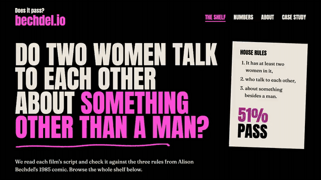

# bechdel.io

[](https://bechdel.joekarlsson.com/)
[](https://github.com/JoeKarlsson/bechdel-test/actions/workflows/site.yml)
[](LICENSE)



Bechdel.io checks movie scripts against the Bechdel Test: are there at least two
women, do they talk to each other, and do they talk about something other than a
man. It sorts a wall of movies most people have already seen into pass and fail,
and about half of them fail, a lot of them favorites.

[See the shelf at bechdel.joekarlsson.com](https://bechdel.joekarlsson.com/) ·
[Read the full statement](https://www.joekarlsson.com/work/bechdel-io/)

## Quick start

Node 22 or later, and API keys for [OMDB](https://www.omdbapi.com/apikey.aspx)
and [TMDB](https://www.themoviedb.org/settings/api).

```sh
git clone https://github.com/JoeKarlsson/bechdel-test.git
cd bechdel-test
npm install
cp .env.example .env    # fill in OMDB and THEMOVIEDB

cd site
npm install             # npm 12, see packageManager in site/package.json
npm run dev             # http://localhost:4321
```

## Adding films

There is no server or database. You run the analyzer locally and commit what it
writes:

```text
scripts/<title>.txt --npm run analyze--> data/films/<id>.json --site/ build--> GitHub Pages
```

```sh
npm run fetch-scripts                        # download IMSDb scripts we lack into scripts/local/
npm run fetch-script-slug                    # same for Script Slug (needs pdftotext; tesseract for scans)
npm run recover-scripts                      # swap unusable scripts for a clean Daily Script copy
npm run match                                # guess the IMDb id for new scripts (check the guesses)
npm run analyze                              # every scripts/*.txt not already on the site
npm run analyze -- scripts/heat.txt          # one film
npm run analyze -- --force scripts/heat.txt  # redo a film that's already on the site
```

Gotchas:

- Each script's film comes from `scripts/manifest.json` (file name to IMDb id).
  A remake can share its title, so check `match`'s guesses, and set `null` for a
  script with no released film.
- Downloaded scripts belong to their writers, so they stay in the gitignored
  `scripts/local/`. The repo keeps only manifest entries and analyses.
- `analyze` refuses a script whose dialogue is under 90% English words (checked
  against `/usr/share/dict/words`).
- OMDB and TMDB responses are cached in `.cache/`. Delete it to refetch.

## Development

```sh
npm test         # the parser and analysis
npm run eval     # score the analysis against bechdeltest.com readers (-- --list for every miss)
npm run ratings  # refresh those ratings after adding scripts
npm run lint

cd site
npm run build && npm test && npm run e2e
```

Pushing `main` runs the Site workflow, which builds, tests and deploys to GitHub
Pages only if every check passes. Publishing steps are in
[DEPLOYMENT.md](DEPLOYMENT.md), and the design is in
[docs/ARCHITECTURE.md](docs/ARCHITECTURE.md). Want scripts to test with? Try
[Movie Script Scraper](https://github.com/JoeKarlsson/movie-script-scraper).

## Credits

Made with my sister, [Laurel Karlsson](https://github.com/laurelcarlson), in
2015. The test comes from Alison Bechdel's 1985 comic strip The Rule. See
[CONTRIBUTING.md](CONTRIBUTING.md) to send a pull request.

## License

MIT. See [LICENSE](LICENSE).
