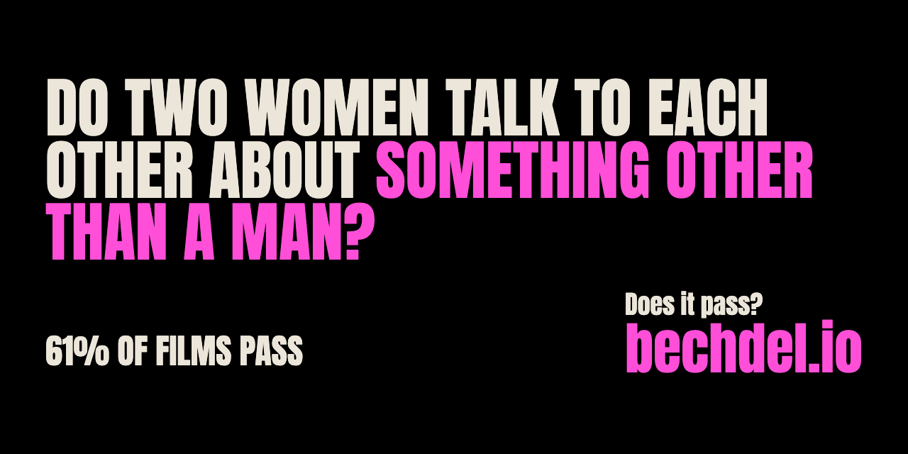

<p align="center">
 

</p>
<h1 align="center">bechdel.io</h1>
<h3 align="center">Find out if your favorite film passes the test</h3>

[![Coverage Status][cover]][cover-url]
[![Build Status][tests]][tests-url]
[![Maintainability][maintainability]][maintainability-url]
[![stars][stars]][stars-url]
[![pr][pr]][pr-url]
[![license][license]][license-url]
[![twitter][twitter]][twitter-url]
[](http://www.firsttimersonly.com/)

## Recording (November 2026)


What Bechdel.io looked like in November 2026, recorded for [its page on joekarlsson.com](https://www.joekarlsson.com/work/bechdel-io/). The full-quality video is [2026-11-recording.mp4](.github/readme/2026-11-recording.mp4).

## The Bechdel Test, sometimes called the Mo Movie Measure or Bechdel Rule is a simple test which names the following three criteria

1. It includes at least two women
2. who have at least one conversation
3. about something other than a man or men.

The test was popularized by Alison Bechdel's comic Dykes to Watch Out For, in a 1985 strip called The Rule. For a nice video introduction to the subject please check out The Bechdel Test for Women in Movies on [feministfrequency.com](http://feministfrequency.com/).

This project analyzes movie scripts to see whether each film passes the Bechdel Test, and looks at several other feminist components of a film. It can answer questions like "How many females are in this film," "By what factor does this pass the Bechdel Test?"

## How it works

The site at https://bechdel.joekarlsson.com/ is fully static: an Astro build in `site/`, deployed to GitHub Pages. There is no server or database. Films are added by running the analyzer locally and committing what it writes.

```
scripts/<title>.txt ──npm run analyze──▶ data/films/<id>.json ──site/ build──▶ GitHub Pages
```

For each script, `npm run analyze` looks the film up on OMDB, gets the cast and their genders from TMDB, scores the Bechdel Test from the script text, and (optionally) asks an AI model, through the homelab LiteLLM gateway, for a second opinion and a deeper read. The AI read is stored with each film but isn't shown on the site (`showAiReadings` in `site/src/pages/films/[slug].astro`). See [docs/ARCHITECTURE.md](docs/ARCHITECTURE.md).

## Add films

Needs Node 22 or later, API keys for [OMDB](https://www.omdbapi.com/apikey.aspx) and [TMDB](https://www.themoviedb.org/settings/api), and for the AI read a LiteLLM virtual key (on the LAN or over Tailscale).

```sh
git clone https://github.com/JoeKarlsson/bechdel-test
cd bechdel-test
npm install
cp .env.example .env    # then fill in the keys

npm run fetch-scripts                        # download IMSDb's scripts we lack into scripts/local/
npm run fetch-script-slug                    # download Script Slug's films we lack into scripts/local/ (needs pdftotext)
npm run recover-scripts                      # replace scripts with unusable dialogue by a clean Daily Script copy
npm run match                                # find the film for any new script (check the guesses)
npm run analyze                              # every scripts/*.txt not already on the site
npm run analyze -- scripts/heat.txt          # one film
npm run analyze -- --force scripts/heat.txt  # redo a film that's already on the site
npm run analyze -- --no-ai ...               # skip the AI read (a redone film keeps its old one)
```

Each script's film comes from `scripts/manifest.json` (file name to IMDb id). `npm run match` adds guesses for new scripts by title, and refuses any whose OMDB title differs from the file name; check the rest (a remake can share its title), fix a wrong id by hand, and set `null` for a script with no released film. Downloaded scripts belong to their writers, so they stay in the gitignored `scripts/local/`: the repo keeps only their manifest entries and analyses. `fetch-script-slug` writes its entries itself from the IMDb id on each page, and OCRs scanned or garbled PDFs (needs tesseract). Both fetchers strip watermarks and page breaks and repair mangled quotes. `analyze` refuses a script whose dialogue is under 90% English words (checked against `/usr/share/dict/words`): a bad scan whose score would be noise. `recover-scripts` looks for a clean copy of each such script on The Daily Script and lists those it can't fix. `analyze` ends with a table of every film's score next to the bechdeltest.com readers' rating. OMDB and TMDB responses are cached in `.cache/`; delete it to refetch.

Then publish: see [DEPLOYMENT.md](DEPLOYMENT.md).

```sh
npm test         # the parser and analysis
npm run eval     # score the analysis against bechdeltest.com readers (add -- --list for every miss)
npm run ratings  # refresh those ratings after adding scripts
npm run lint
```

## Where to Get Movie Scripts?

If you are looking to get your hands on some movie scripts to test, you can check out my CLI Movie Script Grabber [https://github.com/JoeKarlsson/movie-script-scraper](https://github.com/JoeKarlsson/movie-script-scraper)

## Introduction

The Bechdel Test Script Parser was a collaborative digital humanities project between myself and my sister, Laurel Karlsson. It is the product of a shared passion for film, feminism, and the creative potential of technology. By combining the talents and interests of myself, a software engineer, we've been able to create an innovative data mining tool for film analysis that we hope to continue to work on and improve. You can check out the project on our [website](https://bechdel.joekarlsson.com/).

This project was born when my sister reached out to me for advice on a few ideas she had been mulling over for a digital humanities project. Hoping to do something related to feminist film analysis, she was feeling very limited by my lack of coding experience and hadn't been able to find an existing data mining tool to accomplish what she was looking to do. I immediately offered up my coding expertise, looking to gain experience by building a tool from scratch which would accomplish the specific needs of the project. After brainstorming several different project ideas, we settled on the one you see here.

## Contributing

Please read [CONTRIBUTING.md](https://github.com/JoeKarlsson/bechdel-test/blob/main/CONTRIBUTING.md) for details on our code of conduct, and the process for submitting pull requests to us.

### TLDR

1. Fork it!
1. Create your feature branch: `git checkout -b my-new-feature`
1. Commit your changes: `git commit -am 'Add some feature'`
1. Push to the branch: `git push origin my-new-feature`
1. Submit a pull request :D

### Maintainers

<table>
  <tbody>
    <tr>
      <td align="center">
        
        <br />
        <a href="https://github.com/JoeKarlsson">Joe Karlsson</a>
      </td>
   <td align="center">
        
        <br />
        <a href="https://github.com/laurelcarlson">Laurel Karlsson</a>
      </td>
    <tr>
  <tbody>
</table>

### License

#### [MIT](./LICENSE)

## Related Links

- [The Internet Movie Script Database (IMSDb)](http://www.imsdb.com/)
- [The Open Movie Database](http://www.omdbapi.com/)
- [Visualizing and Analyzing the Hollywood Screenplay with ScripThreads](http://www.digitalhumanities.org/dhq/vol/8/4/000190/000190.html)
- [Check out our Trello board for next steps](https://trello.com/b/Ldg9sYtf/bechdel-test)

### Resources

[tests]: https://travis-ci.org/JoeKarlsson/bechdel-test.svg?branch=main
[tests-url]: https://travis-ci.org/JoeKarlsson/bechdel-test
[maintainability]: https://api.codeclimate.com/v1/badges/7d2a095c01bb88557a41/maintainability
[maintainability-url]: https://codeclimate.com/github/JoeKarlsson/bechdel-test/maintainability
[pr]: https://img.shields.io/badge/PRs-welcome-brightgreen.svg
[pr-url]: CONTRIBUTING.md
[cover]: https://coveralls.io/repos/github/JoeKarlsson/bechdel-test/badge.svg?branch=main
[cover-url]: https://coveralls.io/github/JoeKarlsson/bechdel-test?branch=main
[stars]: https://img.shields.io/github/stars/JoeKarlsson/bechdel-test.svg?style=flat-square
[stars-url]: https://github.com/JoeKarlsson/bechdel-test/stargazers
[license]: https://img.shields.io/github/license/JoeKarlsson/bechdel-test.svg
[license-url]: https://github.com/JoeKarlsson/bechdel-test/blob/main/LICENSE
[twitter]: https://img.shields.io/twitter/url/https/github.com/JoeKarlsson/bechdel-test.svg?style=social&style=flat-square
[twitter-url]: https://twitter.com/intent/tweet?text=Wow:&url=https%3A%2F%2Fgithub.com%2FJoeKarlsson%2Fbechdel-test


